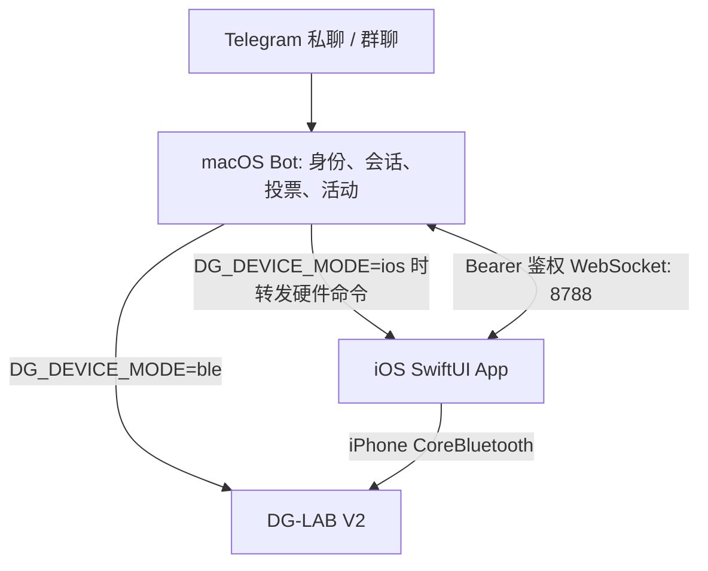

# DG-LAB Telegram Bot for macOS

[中文](README.md) · **Unofficial / community-developed** · [iOS App](https://github.com/shzxm/dglab-ios) · [MIT License](LICENSE)

运行在 macOS 的 DG-LAB V2（`ESTIM01`）Telegram 多人控制服务。基于 **Node.js + TypeScript + Telegraf + BLE**，将 Telegram Bot 的管理员、投票、直播活动操作转换为设备会话与 A/B 控制。还提供 **独立 WebSocket 桥接**，可与 [DG-LAB Control for iOS](https://github.com/shzxm/dglab-ios) 协同工作。

> **非 DG-LAB 官方项目；实验性软件。** 新安装默认 `DG_DEVICE_MODE=mock`，不连接真实蓝牙。**强度上限 133 是软件取值范围，不是人体安全阈值**。真实设备测试必须有独立、立即可用的硬件停止手段。开发测试不能替代真实设备安全验收。

## 核心功能

| 模块 | 功能 |
|---|---|
| Telegram 单人控制 | 管理员会话，管理员直接操作 A/B 强度和波形；非管理员只读 |
| 多人投票 | 邀请码、群绑定、5 秒投票窗口；A/B 强度、波形独立计票和结算 |
| 活动/直播 | 10 秒临时操作员队列、随机选择操作员、动作池（全部、温和、仅强度、仅波形） |
| A/B 强度 | `±1`、`±3`、`±5`、各通道独立会话限幅、按钮操作限速 |
| 自动提升 | A/B 独立开关；每次自动 `+1`，间隔 **1–60 秒**，累计 **+1–33 级**或先达到通道上限即停止；Telegram 面板提供常用间隔直选，iOS 端有连续长滑杆 |
| 波形 | 内置 6 种导入波形；A/B 各自播放、切换和循环，源代码提供额外基础波形编译能力 |
| 系统音频 | ScreenCaptureKit 读取 macOS 输出的 RMS，不保存音频；音量响应与节拍响应可独立或同时开启 |
| 节拍频率 | 固定 1、20、50、100 Hz 与多组区间预设；`/audiofreq <min> <max>` 支持 1–100 Hz，iOS 端可双手柄自定义例如 5–88 Hz |
| OBS 叠加层 | `/obs` 浏览器叠加画面和 `/state` 状态 JSON，默认仅回环地址 |
| iOS 桥接 | 远程控制 Mac BLE 或由 iPhone 取代 Mac 担任 BLE 主机；独立桥接密钥、状态快照、命令确认与本机授权 |
| 安全机制 | 会话限时、设备停止/归零、投票/身份限制、启动丢弃 Telegram 离线积压命令、桥接命令限速 |

**自动提升的累计上限是本轮真正自动执行的 +1 次数，不是目标绝对强度。** 例如初始 20，最大累计 +10，正常到 30 后停止；手动改变强度不算自动提升次数。调整间隔不会重置已累计次数，达到强度上限提前停止。手动关掉自动提升只取消计时器，**不自动降低已达到的强度**。紧急停止仍尝试双通道归零。

节拍 Hz 指 DG-LAB V2 波形周期，而非音乐音调、输出电流或“刺激强度”。声音响应调制波形节奏，不自动更改 S 强度；但若用户同时开启自动提升，后者依然会提高强度。

## 与 iOS App 如何协作

**配套 App**：[github.com/shzxm/dglab-ios](https://github.com/shzxm/dglab-ios)。Bot 和 App 是两个独立项目，**Telegram Bot Token 只保留在 macOS**，手机仅使用另一份独立桥接密钥。

| 工作模式 | macOS 的 `DG_DEVICE_MODE` | 谁连接 DG-LAB 蓝牙 | iOS App 扮演什么角色 |
|---|---|---|---|
| 仅 Telegram 调试 | `mock`（默认） | 无真实连接 | 可选；用于验证状态和命令 |
| Telegram + Mac BLE | `ble` | **Mac** | 远程控制面板；Bot 管理 Telegram 群聊和蓝牙 |
| Telegram + iPhone BLE 主机 | `ios` | **iPhone** | 设备主机；手机现场批准每次会话，Bot 负责 Telegram 多人逻辑 |
| iOS 完全独立 | 不要求启动 Bot | **iPhone** | App 单独控制，与本仓库无运行时依赖 |



**两条 BLE 线路互斥。** `ios` 模式需要 iPhone 本地再次确认授权，不能用 iPhone 的桥接密钥绕过手机本地限幅。完整关系、协议和部署说明见 [docs/ARCHITECTURE.md](docs/ARCHITECTURE.md) 与 [docs/IOS_BRIDGE.md](docs/IOS_BRIDGE.md)。

## macOS 原生独立 App（SwiftUI）

原生 [DG-LAB Console for macOS](macos/DGLabConsole/README.md) 已升级为**自包含安装包**：包含原控制器的完整 TypeScript/Node.js 生产服务、macOS BLE、系统音频辅助程序、Telegram、投票/活动、OBS、iOS WebSocket 桥接和本地 API。App 内的 SwiftUI 主进程负责启动、停止和监控自己的内置 Node 子进程，**不再依赖另外安装的 Homebrew Node 或旧 `com.dglab.telegram-bot` LaunchAgent**。

- **默认安全模式**：首次打开不自动启动引擎；设备模式为 `mock`，用户点击「启动内置引擎」才运行。可先执行「安全 Mock 自检」，不连接 Telegram 或蓝牙。
- **权限中心**：蓝牙、麦克风、屏幕录制、系统音频实际短时测试、通知、局域网设置、文件选择、可选辅助功能各有独立按钮；不能绕过 macOS 已拒绝的 TCC 授权。
- **完整控制**：设备与会话、A/B 强度/波形、1–60 秒自动提升间隔与累计 +1–33、音量与节拍、Telegram 多人/直播/投票、OBS、本地 API、iOS 桥接。
- **无重复轮询**：旧 LaunchAgent 应保持卸载。只有内置引擎持有 Telegram Bot Token 和蓝牙控制权。真正停止前确认会话 inactive 且 A/B 已归零。
- **本地 API**：`http://127.0.0.1:8789`，独立 Bearer 密钥鉴权（macOS App 使用私有本地文件）、命令白名单、连接/授权二次确认；参阅 [docs/LOCAL_CONTROL_API.md](docs/LOCAL_CONTROL_API.md)。

注意：这属于**SwiftUI App + 应用内嵌的 Node.js 控制引擎**，并非把每一行原来的 TypeScript 重写成 Swift。正式 App 无额外 Node 运行环境依赖，但真实 BLE 连接与系统音频 TCC 权限仍需要用户现场授权及实体设备验收。

## 环境要求

- macOS，具备蓝牙硬件（真实 Mac BLE 模式），Node.js **20+**、npm；建议使用已登录桌面的用户运行。
- Telegram BotFather 创建的 Bot Token；管理员 Telegram 数字 `user_id`。
- DG-LAB V2 / ESTIM01（**只有真实设备模式**才需要）。
- macOS 屏幕和系统音频录制权限（只有系统音频响应需要）。
- iOS 协同时：单独随机生成的 `IOS_BRIDGE_TOKEN` 与可信网络/加密 WSS。

## 快速启动：先从 Mock 开始

```bash
git clone https://github.com/shzxm/dglab-telegram-bot.git
cd dglab-telegram-bot
npm ci
cp config.example.json config.json
```

编辑 **未跟踪的** `config.json`（只是说明，使用前填写自己的管理员 ID / Bot Token；生产环境建议把 Token 放 Keychain）：

```json
{
  "telegramToken": "REPLACE_WITH_BOTFATHER_TOKEN",
  "ownerUserId": 123456789,
  "allowedChatId": 123456789,
  "deviceMode": "mock",
  "strengthLimit": 30,
  "sessionDurationSeconds": 9999,
  "voteWindowSeconds": 5,
  "actionWindowMs": 1000,
  "actionsPerWindow": 3,
  "obsHost": "127.0.0.1",
  "obsPort": 8787
}
```

`config.json`、`.env` 均已列入 `.gitignore`；环境变量可覆盖文件配置。默认用户 ID 示例是占位数据，**勿提交自己的实际 Token、Telegram ID 或聊天记录**。

验证：

```bash
npm run typecheck
npm test
npm run build
npm run doctor
npm run demo
npm run dev
```

在 Telegram 中向 Bot 发送 `/start`、`/help`、`/status` 获取按钮和会话状态。常用命令还有 `/connect`、`/newsession`、`/arm`、`/panel`、`/stop`、`/disarm`、`/disconnect`、`/join <邀请码>`、`/audiofreq 5 88`。`/audiofreq 50 50` 表示固定 50 Hz。

## 从 Mock 切换到真实 Mac BLE

1. 确认设备关闭其他手机端连接，Mac 已授予终端/Node 蓝牙权限，并且硬件停止方式触手可及。
2. 使用 `npm run ble:scan` 扫描，`npm run ble:probe` 执行读取和归零探测；不要使用低强度测试标志，除非已做好真实设备安全准备。
3. 在停止活动会话后，将 `deviceMode` / `DG_DEVICE_MODE` 改为 `ble`，再重新启动服务。
4. 在 Telegram 中明确授权会话后才能操作。每轮结束可使用停止/断开按钮。

> 同一台设备不能同时被 iPhone App 和 Mac BLE 占用。`mock`、`ble`、`ios` 不要在活动会话期间切换。

## Telegram 邀请、群聊与活动

- 管理员创建并授权会话后，Bot 生成可重复使用的短邀请码，Telegram 私聊用户可使用 `/join 邀请码` 加入。
- 要在群聊共享控制面板，管理员使用 `/bindgroup 邀请码`；Bot 应具备足以验证群成员的权限，但不需要不必要的聊天内容读取权限。
- 投票模式按强度和波形、A 和 B 四种类别分别结算；每个参与者每轮限投对应类别一次。
- 活动模式支持 10 秒临时操作员、队列与管理员随机抽取；临时权限仍受强度/动作池/限速约束，不能停止或断开设备。
- Bot API **无法可靠获取 Telegram 语音/视频聊天中的实时参会名单**；普通群成员身份不等于直播在线观众身份。

## A/B 自动提升与声音响应

- Telegram 面板：两通道独立开关，提供 **1 / 3 / 5 / 7 / 11 / 13 / 17 秒**常用间隔按钮。
- iOS App：长滑杆可选 1–60 秒整数间隔，并设置累计自动增加 1–33 级后自动关闭。修改执行中的间隔保留已累计的次数。
- 音量响应：安静时波形按 0.25 倍步进播放，有音量时恢复常速，不会因为静音自动降强度。
- 节拍响应：RMS 上升沿切换波形周期。固定模式不随节拍改变频率；区间模式在低/高频端切换。
- Mac 原生系统音频辅助程序位于 [`native/system-audio-meter.swift`](native/system-audio-meter.swift)，仅输出数值化 RMS。构建命令：

```bash
mkdir -p bin
swiftc -O -parse-as-library native/system-audio-meter.swift \
  -o bin/system-audio-meter \
  -framework ScreenCaptureKit -framework AVFoundation -framework CoreMedia
mkdir -p "$HOME/.local/bin"
cp bin/system-audio-meter "$HOME/.local/bin/dglab-system-audio-meter"
```

声控需要 macOS 的屏幕/系统音频权限；没有授权不能正常分析。捕获助手退出或连续 5 秒没有音频数值时，会尝试停止会话并归零。音频模式可以和自动提升独立开启，但叠加效果更难预测。

## OBS 叠加层

浏览器来源：`http://127.0.0.1:8787/obs`；JSON 状态：`http://127.0.0.1:8787/state`。推荐 OBS 浏览器源约 `760 × 420`。两者默认只对 Mac 本机开放，不应直接暴露在公网。

## 配置 iOS WebSocket 桥接

**不启用时无需配置**。只要有至少 32 字符的 `IOS_BRIDGE_TOKEN`，程序即可启动独立桥接服务器；默认仅监听 `127.0.0.1:8788`。

```bash
# 在 macOS 上生成单独的随机桥接密钥，不要输出到 GitHub / 日志
openssl rand -hex 32

# 示例使用变量名，正式部署建议从 Keychain 注入环境
export IOS_BRIDGE_TOKEN="PASTE_YOUR_64_CHAR_RANDOM_HEX_SECRET_HERE"
export IOS_BRIDGE_HOST="127.0.0.1"  # 本机默认；手机连接时改为受信任的 Mac LAN IP
export IOS_BRIDGE_PORT="8788"
```

在 iOS App「Telegram」界面填写 `ws://<Mac局域网IP>:8788` 和**桥接专用密钥**，选择「远程控制 Bot」；先用 `DG_DEVICE_MODE=mock` 测试，再决定是否启用 `ble` 或 `ios`。切换为 `ios` 之前需要停止现有会话、断开 Mac 蓝牙，并确认手机端已经建立独立 BLE 连接。

- Bot Token 只留在 Mac；App **不启动第二个 Telegram 轮询进程**。
- 手机主机模式的 `device.connect` 必须在 iPhone 上再次现场同意，Mac 的 Telegram 管理员权限不能越过手机强度上限。
- 桥接密钥视为管理员权限，绝不能发给参与投票的普通用户。
- 非私有网络只使用 `wss://` 和额外访问控制，禁止把 `ws://:8788` 公网裸露。

更详细的端点列表、JSON 消息格式和权限限制见 [docs/IOS_BRIDGE.md](docs/IOS_BRIDGE.md)。

## 生产环境与 LaunchAgent

可使用 `npm run build` 的 `dist/src/index.js` 配合 macOS `LaunchAgent` 运行：

1. 从 [`launchd/com.dglab.telegram-bot.plist.example`](launchd/com.dglab.telegram-bot.plist.example) 复制模板至 `~/Library/LaunchAgents/com.dglab.telegram-bot.plist`，根据自己的目录调整 `WorkingDirectory` 和启动脚本。
2. 强烈建议使用 **macOS Keychain + 启动包装脚本**传递 `TG_BOT_TOKEN`、`IOS_BRIDGE_TOKEN`；不把凭证写入 plist 或版本库。
3. 启动与检查：

```bash
uid=$(id -u)
launchctl bootstrap "gui/$uid" "$HOME/Library/LaunchAgents/com.dglab.telegram-bot.plist"
launchctl print "gui/$uid/com.dglab.telegram-bot"
# 仅在确认没有活动真实设备会话后重启
launchctl kickstart -k "gui/$uid/com.dglab.telegram-bot"
```

**重启或替换设备模式前必须确认活动会话已结束并安全归零**。现有 Bot 启动时会丢弃排队的旧 Telegram 指令，避免重新启动后误执行历史按钮。

## 项目结构

```text
src/index.ts                Bot 命令、会话与 iOS 桥接路由
src/control.ts              会话/投票/身份和强度约束
src/coyote-v2.ts            Mac 蓝牙与波形写入
src/auto-ramp.ts            双通道限额自动提升
src/audio-reactive.ts       Mac 系统音频特征分析与频率映射
src/ios-bridge.ts           独立 WebSocket 桥接服务
src/ios-relay-device.ts     iPhone 蓝牙主机的代理设备
native/system-audio-meter.swift  macOS ScreenCaptureKit RMS 助手
src/obs-overlay.ts          OBS 状态服务
config.example.json         安全示例配置
launchd/                    macOS 服务模板
```

## 测试与现有局限

- `npm run typecheck && npm test && npm run build` 运行 Mock / 无实体设备测试。2026-11-17 已验证 **36 项 Vitest 测试通过**。
- `iOS` 远程蓝牙主机协议和 CoreBluetooth 目前**未完成 iPhone 实物验收**；不能因为桥接测试通过就保证实际停止/归零消息一定能送达硬件。
- `133` 是软件上限，不能用来推断人体耐受或医疗用途。
- 如果要参与开发，请提交可复现的 Mock 测试与最小变更，不要上传 Token、家庭网络配置或聊天记录。更多说明见 [docs/SECURITY.md](docs/SECURITY.md)。

## 许可

[MIT License](LICENSE)。本项目与 DG-LAB 官方没有隶属、背书或认证关系。

## 原生 iOS App（本仓库新增）

完整的 SwiftUI 项目已收录在 [ios/](ios/)。可通过 Xcode 27.2、XcodeGen 和自己的开发者证书编译安装，不需要 App Store 上架。支持 V2 BLE 连接、双通道手动控制、独立上限、1–60 秒自动提升间隔、+1 至 +33 的停止阈值、双端节拍区间滑杆，以及经独立随机密钥保护的 Telegram WebSocket 桥接。实际手机与硬件需要自行验收。

## 与药时 PK Atlas 跨应用互动

另一个独立项目：[药时 · PK Atlas](https://github.com/shzxm/pk-atlas)，包含 Web/PWA 和 SwiftUI iOS App。

- 在本 iOS App **设置 → 打开药时**，主动打开 pkatlas://open?source=dglab。
- 在药时 iOS **更多 → 打开 DG-LAB 控制台**，主动打开 dglabcontrol://open?source=pkatlas。
- 两个方向只切换应用前台，不传递服药记录、账号、强度、频率、WebSocket 凭证或电刺激命令。
- **不存在药代数值自动控制 DG-Lab 的功能。** URL 唤起绝不会自动授权或启动设备。

详细协议和风险说明：[docs/PK_ATLAS_INTEROPERABILITY.md](docs/PK_ATLAS_INTEROPERABILITY.md)。

## 源码许可与安全

项目使用 [MIT License](LICENSE)。DG-Lab、Telegram、iOS 和其他第三方商标属于各自权利人，本项目非官方软件。示例配置为占位符；个人 Token、Keychain 凭据、聊天记录、设备日志、已签名 IPA 和本机配置**不得提交**。即使软件限幅最高为 133，也不代表任何人体安全强度。

### macOS Console v1.1.1 更新

改进独立 App 的 1 秒状态刷新、设备连接超时与未连接提示、A/B 独立投票卡片、录屏授权系统设置入口及局域网说明，移除无实际使用场景的文件访问演示按钮。**关闭 App 不再直接中断 Node**：先等待设备停止/断开与状态验证，再结束引擎；失败时取消退出并显示错误。详细行为见 [macOS Console README](macos/DGLabConsole/README.md)。

### macOS Console v1.2.0：本地密钥与诊断日志

API 桥接密钥、Telegram 凭证改为 **App 专属 Application Support 本地文件**（`0700/0600`），不再访问 macOS Keychain，因此不触发钥匙串授权。原有钥匙串密钥不会自动迁移，首次需要重新同步 iOS 桥接密钥、Telegram Token。新增持久化、脱敏、限大小的 App/Node 日志以及「本地 API → 导出诊断日志」按钮，可选择文件路径导出 `.txt`，方便排错。详见 [App README](macos/DGLabConsole/README.md)。

### macOS Console v1.3.0：启动与旧版冲突处理

新版 macOS App 的所有页面顶部都能看到「启动控制引擎」。如果旧版 `com.dglab.telegram-bot` LaunchAgent 占用 OBS/API/iOS Bridge 端口，则显示「安全切换旧后台」，用户确认后先核查旧会话 inactive 和 A/B=0，再卸载旧 LaunchAgent、等待端口释放后启动新 App 内嵌引擎。旧服务也能在新引擎停止后恢复。**软件确认零输出并不代表在蓝牙失联时实体设备保证停止，实际使用仍需可立即触及的物理停止方式。**

新版内置引擎状态界面区分 API 已连接、Telegram 正在初始化/在线/故障、设备 BLE 连接，并提供具体错误；系统音频将区分找不到屏幕/窗口的 ScreenCaptureKit -3815 故障与授权拒绝。局域网桥接 IP 由用户手动确认后填入，只推荐私有 IPv4，不会自动向公网开放端口。详情见 [macOS App README](macos/DGLabConsole/README.md)。
