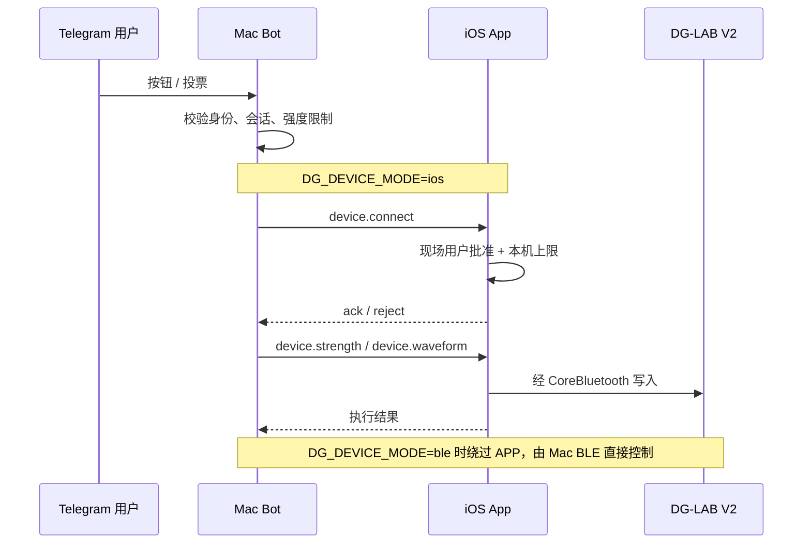
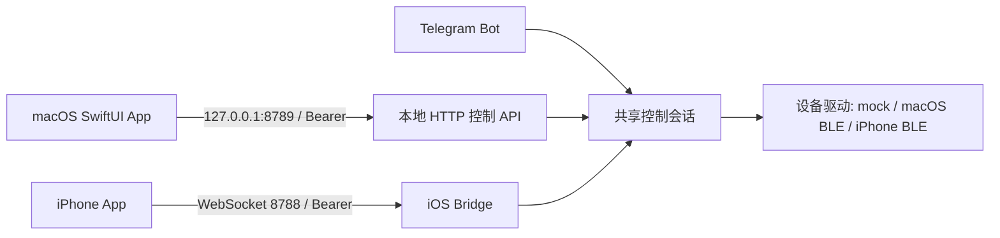

# macOS Bot 与 iOS App：协作和数据流

iOS App 源码：<https://github.com/shzxm/dglab-ios>。

## 各组件的所有权

| 功能 | macOS Bot | iOS App |
|---|---|---|
| Telegram Bot Token 与长轮询 | 唯一拥有者 | 不接触 Bot Token |
| Telegram 参加/投票/活动/队列 | 身份、限速、结算 | 可展示和发管理员操作请求 |
| 真实 BLE 输出 | `DG_DEVICE_MODE=ble` 时控制 Mac BLE | 独立模式或 `ios` 主机模式控制 iPhone BLE |
| 限幅和授权 | Bot 会话独立限额、停止和有效期 | 本地现场再次授权和独立强度上限 |
| 系统音频 | ScreenCaptureKit macOS 系统输出的 RMS | 分析麦克风/应用内音频，或接收 MBP RMS |
| OBS 面板 | 提供 `/obs`、`/state` | 可打开 OBS 链接，不能接替 OBS 服务 |

## 同一设备的互斥模式

- `mock`：无真实设备输出，适用于测试和部署验证。
- `ble`：Mac 蓝牙连接设备，iOS App 是**远程控制面板**，不另外连接同一设备。
- `ios`：Mac 不操作蓝牙，Bot 处理群成员/投票和命令，将设备指令转发给 iPhone；**手机本地确认后才允许输出**。
- iPhone 独立控制：不需要此 Bot，手机独立通过 CoreBluetooth 控制设备。

## 消息和信任关系

桥接控制帧使用 JSON，经高熵 `IOS_BRIDGE_TOKEN` Bearer 授权；**手机端密钥不是 Telegram 用户身份**，拥有者应将其视为管理员凭证。默认不对 LAN 或公网监听，需明确配置 `IOS_BRIDGE_HOST`。

详细协议： [IOS_BRIDGE.md](IOS_BRIDGE.md)。安全约束： [SECURITY.md](SECURITY.md)。

## macOS 原生控制台与本地 HTTP API

除了 Telegram 群聊和 iOS App，现在还提供 [macOS SwiftUI 控制台](../macos/DGLabConsole/README.md)。它不创建新的 Telegram Bot，不单独操控蓝牙，而是使用与 iOS Bridge 同一份独立密钥连接 **127.0.0.1:8789** 的本地 API，复用 Bot 的真实会话状态、设备、波形和音频逻辑。服务与界面独立运行，关闭 GUI 不会关闭后台 Bot。

本地 API 仅绑定 loopback；未经认证无法查询会话状态或修改设备。修改会话授权和连接设备需要明确确认请求头，停止会话不受普通 API 限速。详情见 [LOCAL_CONTROL_API.md](LOCAL_CONTROL_API.md)。

## macOS 自包含 App v1.1.0

从 2026-11-17 起，SwiftUI 控制台升级为独立运行应用：`DG-LAB Console.app` 自带 ARM64 Node 24.13.0、完整 Bot 生产依赖、波形/声音/Telegram 逻辑及内置 ScreenCaptureKit helper。它不借用 Mac 已安装的 Node，也不要求旧 LaunchAgent 运行。**GUI 进程管理自己 bundle 内的 Node 子进程，两者均属于同一款 App**。

- 默认不启动任何引擎；首次选择 `mock`，可通过「安全 Mock 自检」验证端口及离线控制。
- 点击「启动内置引擎」后，由内嵌进程监听 `127.0.0.1:8787/8789`，iOS WebSocket 默认 `127.0.0.1:8788`。若发现外部服务占用这些端口，拒绝重复启动。
- macOS App 1.2.0 起：Telegram 凭证、桥接密钥保存在用户专属 Application Support 私有目录的 `credentials.json`（目录 `0700`，文件 `0600`），**不再使用 macOS Keychain**。应用安装包中不包含真实 Token；可手动导入旧版非敏感管理员 ID，但旧 Keychain 密钥需要手动重新配置，且**不会自动沿用旧设备的 BLE 模式**。
- 「权限中心」对蓝牙、麦克风、系统录屏/音频、通知等逐一触发 macOS API 申请。仅在用户点击时请求，已拒绝的授权需通过系统设置恢复。
- 退出 App 时会先检查是否存在非零强度或状态不确定的会话，避免一边真实输出一边无提示杀死控制进程；意外退出有子进程父 PID 看门狗尝试安全停机，但物理断连时无法保证归零指令抵达。

更详细的独立构建方案见 [macOS App README](../macos/DGLabConsole/README.md)。
