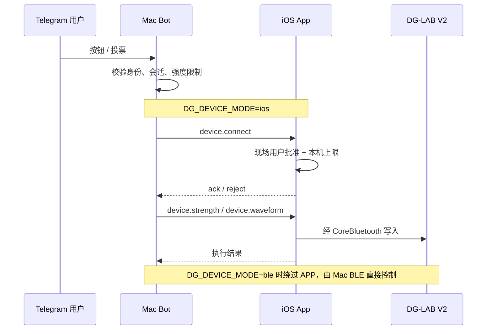

# macOS Bot 与 iOS App：协作和数据流

iOS App 源码：<https://github.com/shzxm/dglab-ios>。

## 各组件的所有权

| 功能 | macOS Bot | iOS App |
|---|---|---|
| Telegram Bot Token 与长轮询 | 唯一拥有者 | 不接触 Bot Token |
| Telegram 参加/投票/活动/队列 | 身份、限速、结算 | 可展示和发管理员操作请求 |
| 真实 BLE 输出 | `DG_DEVICE_MODE=ble` 时控制 Mac BLE | 独立模式或 `ios` 主机模式控制 iPhone BLE |
| 限幅和授权 | Bot 会话独立限额、停止和有效期 | 本地现场再次授权和独立强度上限 |
| 系统音频 | ScreenCaptureKit macOS 系统输出的 RMS | 分析麦克风/应用内音频，或接收 MBP RMS |
| OBS 面板 | 提供 `/obs`、`/state` | 可打开 OBS 链接，不能接替 OBS 服务 |

## 同一设备的互斥模式

- `mock`：无真实设备输出，适用于测试和部署验证。
- `ble`：Mac 蓝牙连接设备，iOS App 是**远程控制面板**，不另外连接同一设备。
- `ios`：Mac 不操作蓝牙，Bot 处理群成员/投票和命令，将设备指令转发给 iPhone；**手机本地确认后才允许输出**。
- iPhone 独立控制：不需要此 Bot，手机独立通过 CoreBluetooth 控制设备。

## 消息和信任关系

桥接控制帧使用 JSON，经高熵 `IOS_BRIDGE_TOKEN` Bearer 授权；**手机端密钥不是 Telegram 用户身份**，拥有者应将其视为管理员凭证。默认不对 LAN 或公网监听，需明确配置 `IOS_BRIDGE_HOST`。

详细协议： [IOS_BRIDGE.md](IOS_BRIDGE.md)。安全约束： [SECURITY.md](SECURITY.md)。
